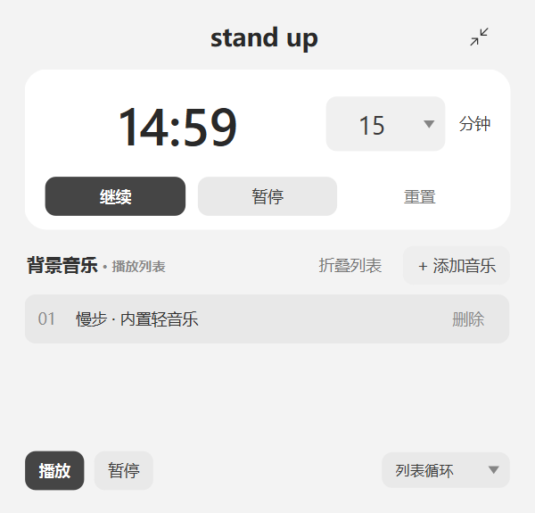
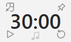

# stand up

提醒你起身活动的小工具，提供 Windows、macOS、Linux 桌面版和安卓试用版。


## 安卓试用版

从 [Releases](https://github.com/zhaopw5/stand-up/releases) 下载 `stand-up-android.apk`，支持 Android 8.0 及以上。
包含倒计时、后台音乐、通知栏和锁屏提醒，无浮窗。使用前请允许通知和准确提醒。
详见 [安卓安装与使用说明](docs/ANDROID.md)，包含 Redmi K70 Pro / Android 16 的锁屏检查方法。

## Windows 版下载与使用

从本仓库的 **Releases** 下载 `stand-up-windows-x64.zip`，解压后双击 `stand up.exe`。
适用于 Windows 10/11 64 位，无需安装 Python。当前版本未进行数字签名。



### 倒计时

- 快捷选择 15、30、45、60 分钟，默认 30 分钟。
- 可以直接输入 1～999 的整数分钟，点击“开始”即可使用新时长；暂停后点“继续”保留进度，点“重置”则采用当前输入时长。
- 计时过程中可暂停、继续；重置会停止计时并恢复当前所选时长。
- 归零后循环播放柔和的六音符提示，每轮约 4 秒。
- 点击倒计时“暂停”或小窗左下暂停图标停止提示音；重置或关闭也会停止。

### 迷你浮窗

点击右上角箭头进入小窗；拖动时间区域移动窗口。



- 左上：恢复完整窗口。恢复时会自动调整位置，避免超出桌面。
- 右上：切换置顶。默认不置顶，深色实心表示已置顶。
- 左下：倒计时开始／暂停／继续，响铃时用于停止提示音。
- 底部中央音符：背景音乐播放／暂停，播放时颜色加深。
- 右下：重置倒计时。

### 背景音乐

添加本地 MP3、WAV、OGG 或 M4A 文件，选中后播放，或双击歌曲播放。
支持顺序播放、单曲循环、列表循环、拖动排序和删除歌曲。
应用内置一首背景音乐；自行添加的本地歌曲不会随应用分发。倒计时结束时自动暂停背景音乐。

## 桌面版当前限制

- 暂不保存播放列表、时长和窗口位置等设置；置顶选择仅在本次运行内保留。
- 暂无安装器、自动更新或代码签名。
- 在开发电脑上验证过主要交互；不同电脑的音频设备、解码支持和显示缩放仍需实际体验。

## 运行电脑版源码

在项目根目录执行：

```powershell
python -m pip install -r requirements.txt
python work_buddy.py
```

## 构建 Windows EXE

```powershell
python -m pip install pyinstaller
python -m PyInstaller "stand up.spec"
```

输出位于 `dist/stand up.exe`。规格文件会收集应用图标和提示音，不需要额外播放器。

## 项目结构

日常统一在 `C:\Users\zpw\Desktop\myApps\standUp` 开发。找代码看前两项，找安装包看 `dist/`。

- `work_buddy.py`：电脑版代码，包括倒计时、音乐和小窗交互。
- `android/`：安卓版代码和构建配置，使用方法见 [安卓说明](docs/ANDROID.md)。
- `dist/`：本地安装包；当前文件的版本情况见本机的 `dist/README.md`。
- `archive/releases/`：历史安装包；新归档按版本号分文件夹保存。
- `assets/`：应用图标、提示音和 Fluent UI 图标资源。
- `music/`：内置背景音乐、音符记录和音频检查资料。
- `scripts/`、`stand up.spec`：资源生成与打包脚本、配置。
- `tests/`：电脑版测试；安卓测试在 `android/app/src/` 下。
- `.github/workflows/`：各平台的自动构建与发布流程。
- `docs/`：各平台使用说明和版本记录。
- `artifacts/`、`build/`：本地截图、检查结果和构建中间文件。
- `archive/`：历史源码备份、设计与交接材料，仅供追溯。

重新生成图标需要额外安装 Pillow。资源生成脚本使用的 `artifacts` 目录只存放本地预览，不提交到仓库。

本地缓存的清理范围见 [清理记录](docs/CLEANUP.md)。

## 图标来源与许可

大小窗切换图标直接选自微软开源 Fluent UI System Icons（MIT），已保留原始 SVG、版权及完整许可文本。详见 [第三方图标声明](THIRD_PARTY_NOTICES.md) 和 [MIT 许可证](assets/fluent/LICENSE)。应用其他依赖的许可证需要分别遵守，本说明不代表完成了整个发行包的许可审查。

## Mac 试用版

已提供 [macOS 下载页](https://github.com/zhaopw5/stand-up/releases/latest)。
Apple M 系列（包括 M2 MacBook Air）选择 `stand-up-macos-arm64.zip`；Intel Mac 选择 `stand-up-macos-x86_64.zip`。
需要 macOS 13 或更新版本。解压后将 `stand up.app` 拖到“应用程序”。
此版本尚未使用 Developer ID 签名或 Apple 公证，首次启动说明见 [Mac 使用说明](docs/MACOS.md)。

Mac 构建由 `.github/workflows/macos.yml` 手动触发，在两种原生 macOS 15 环境完成构建、界面及启动检查。
本地 Mac 也可安装 PySide6、PyInstaller、Pillow 后运行 `python scripts/build_macos.py`。

倒计时结束会自动暂停背景音乐并保留音乐进度，再循环播放提示音；停止提示音后需要手动继续音乐。

## 内置背景音乐

默认列表包含《慢步》：60 秒无歌词、纯合成钢琴风格音乐，无需自行下载，点击播放即可。默认列表循环，不自动播放。仍可添加本地歌曲，或删除列表中的内置曲目（下次启动恢复）。倒计时结束自动暂停背景音乐。制作脚本与音符记录见 scripts/build_background_music.py 和 music/。

## 音乐播放控制

添加后会选中新歌曲；底部使用一个播放/暂停按钮。进度条显示已播放时间和总时长，可拖动定位。失败时显示播放器错误信息；受加密或平台专用格式保护的下载文件不保证可播放。

## 到时提醒方式

完整窗口中可选择提示音或桌面弹窗，默认提示音。弹窗模式归零时不播放提示音，在应用所在屏幕中央显示休息提示，保持显示至确认。两种提醒均自动暂停背景音乐，小窗下同样有效。选择仅在本次运行内保留；macOS 全屏空间可能影响窗口前置。

## Ubuntu Linux 预览版

从 [最新发布页](https://github.com/zhaopw5/stand-up/releases/latest) 下载 stand-up-linux-x86_64.tar.gz，解压后运行其中的 stand up/stand up。保留旁边的 _internal 目录，无需安装 Python。

目标系统为 Ubuntu 24.04 x86_64，需要图形桌面和 PulseAudio/PipeWire 音频服务。在 GNOME Wayland 中，程序默认优先使用可用的 XWayland，以兼容小窗移动和切换；用户显式设置的 Qt 后端会被保留。本次小窗消失修复已在作者的 Ubuntu 电脑上人工确认；其它发行版和桌面环境尚未实测。详见 [Linux 使用说明](docs/LINUX.md)。

## 自动构建与验证

GitHub Actions 的 Build and publish release 可一次构建 Windows x64、Ubuntu x86_64、macOS arm64、macOS x86_64 和安卓。全部构建和自动检查通过后，才统一发布同一版本并附 SHA256SUMS.txt。

Windows 和 Ubuntu 自动检查包含普通/最大化窗口的小窗切换、恢复以及打包程序启动；macOS 保留原生构建和启动检查。自动检查与人工实测分开记录，不代表所有设备和音频行为均已验证。各版本范围见 [发布说明](docs/releases/)。
